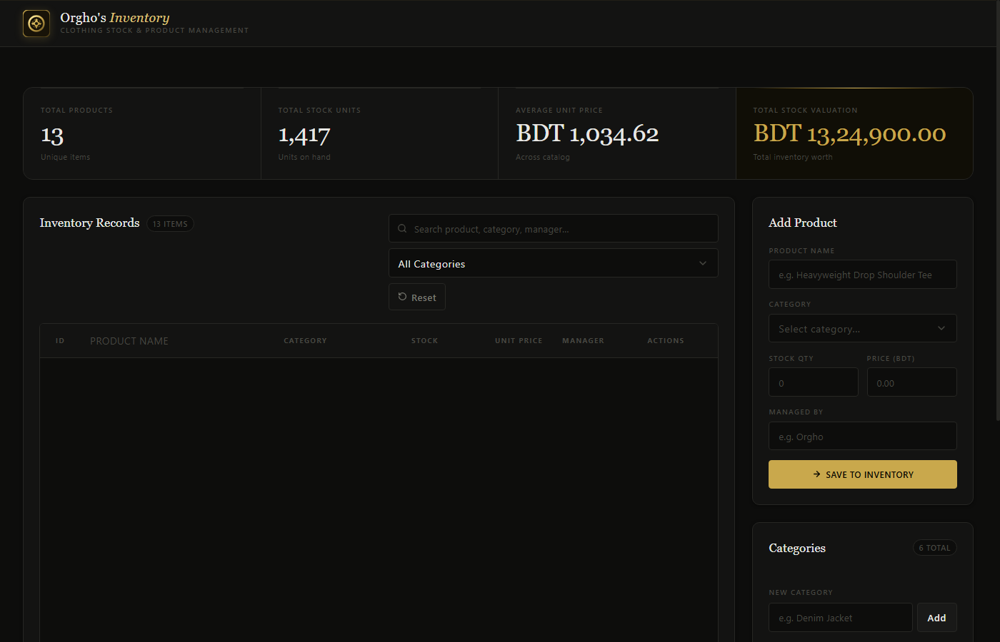

<div align="center">

# FENI UNIVERSITY
### Department of Computer Science and Engineering (CSE)
**Program:** Undergraduate Bachelor of Science (B.Sc. in CSE)

---

### LAB PROJECT REPORT
**Course Title:** Database Management System Lab

<br>

<div style="border: 1px solid #c0c0c0; padding: 22px 20px; background-color: #fafbfc; max-width: 680px; margin: 0 auto;">
<div style="font-size: 10pt; letter-spacing: 2px; color: #555; text-transform: uppercase; margin-bottom: 8px;">PROJECT TITLE</div>
<div style="font-size: 19pt; font-weight: bold; color: #111; margin-bottom: 12px;">Orgho's Inventory — Product Management System</div>
<div style="font-size: 10pt; color: #333;"><strong>GitHub Repository:</strong> <a href="https://github.com/Orgho-009/Inventory-Product-Management-System">https://github.com/Orgho-009/Inventory-Product-Management-System</a></div>
</div>

<br>

---

| **Submitted By** | **Submitted To** |
| :--- | :--- |
| **Name:** Ahmmed Waseg Bin Mizan Orgho | **Name:** Faria Sultana Bintha Rohman |
| **Student ID:** 251031046 | **Designation:** Lab Technical Officer (LTO) |
| **Batch:** CSE 34th Batch | **Department:** Dept. of CSE, Feni University |
| **Program:** B.Sc. in CSE | |
| **Department:** Dept. of CSE, Feni University | |

<br>

**Date of Submission:** November 16, 2026

</div>

<div style="page-break-after: always;"></div>

---

## 1. Project Objective

The objective of this lab project is to design and develop a single-page web application connected to a relational database for managing store inventory records. The system demonstrates practical implementation of core SQL operations (`CREATE`, `INSERT`, `SELECT`, `WHERE`, `UPDATE`, `DELETE`) and SQL aggregate functions (`COUNT()`, `SUM()`, `AVG()`) through a clean, modern user interface. The dataset used in this project represents real apparel and clothing merchandise records.

### Key Features Implemented:
1. **Add Records:** Add new categories and save product records from the single-page UI.
2. **View Records:** Structured table with sequential IDs, categories, stock, prices (`BDT`), and managers (`Orgho`, `Rumon`, `Fahim`).
3. **Search and Filter:** Search by ID, name, category, or manager and filter by SQL `WHERE` / `LIKE`.
4. **Update Records:** Edit and update existing product details using a modal dialog form.
5. **Delete Records:** Delete unused categories and products with foreign-key protection.
6. **Summary Dashboard:** Live `COUNT`, `SUM`, and `AVG` metrics in Bangladeshi Taka (`BDT`).

---

## 2. Tools Used & Project File Structure

**GitHub Repository Link:** [https://github.com/Orgho-009/Inventory-Product-Management-System](https://github.com/Orgho-009/Inventory-Product-Management-System)

### 2.1 Technology Stack

| Component | Technology | Description |
| :--- | :--- | :--- |
| **Frontend** | HTML5, CSS3, JS (`index.html`, `style.css`, `script.js`) | Single-page UI, forms, inventory table, search/filter bar, and modal dialogs. |
| **Backend** | Node.js, Express (`server.js`) | REST API server handling HTTP requests, validation, and SQL execution. |
| **DB Driver** | `mysql2` | Connects Node.js with MySQL using parameterized SQL queries. |
| **Database** | MySQL (`inventory_db`) | Relational database storing `categories` and `products` tables. |

### 2.2 Project File Structure

```text
Inventory-Product-Management-System/
├── database.sql
├── server.js
├── package.json
├── README.md
├── LAB_REPORT.pdf
├── public/
│   ├── index.html
│   ├── style.css
│   └── script.js
└── screenshots/
    ├── dashboard-overview.png
    └── edit-record-modal.png
```

---

## 3. Database Table Design & ER Diagram

### 3.1 Entity-Relationship (ER) Diagram
The database `inventory_db` contains two related tables: `categories` (parent table) and `products` (child table). One category can be associated with multiple products (**1:N relationship**), enforced by a `FOREIGN KEY` constraint on `products.category` referencing `categories(category_name)`.

```text
+------------------------------+                 +-----------------------------------------------+
|          CATEGORIES          |                 |                   PRODUCTS                    |
+------------------------------+                 +-----------------------------------------------+
| PK  category_id INT          | 1 ----------- * | PK  product_id INT                            |
| UK  category_name VARCHAR(50)|                 |     product_name VARCHAR(100)                 |
+------------------------------+                 | FK  category VARCHAR(50)                      |
                                                 |     stock_quantity INT                        |
                                                 |     unit_price DECIMAL(10,2)                  |
                                                 |     managed_by VARCHAR(60)                    |
                                                 +-----------------------------------------------+
```

### 3.2 Table Structure

| Table | Column Name | Data Type | Constraints | Description |
| :--- | :--- | :--- | :--- | :--- |
| `categories` | `category_id` | `INT` | `PRIMARY KEY`, `AUTO_INCREMENT` | Unique ID for each category |
| `categories` | `category_name` | `VARCHAR(50)` | `NOT NULL`, `UNIQUE` | Name of the product category |
| `products` | `product_id` | `INT` | `PRIMARY KEY`, `AUTO_INCREMENT` | Sequential ID for each product |
| `products` | `product_name` | `VARCHAR(100)` | `NOT NULL` | Name of the product |
| `products` | `category` | `VARCHAR(50)` | `NOT NULL`, `FOREIGN KEY` | References `categories(category_name)` |
| `products` | `stock_quantity` | `INT` | `NOT NULL`, `CHECK (>= 0)` | Available units in stock |
| `products` | `unit_price` | `DECIMAL(10, 2)` | `NOT NULL`, `CHECK (>= 0.00)` | Unit price in Bangladeshi Taka (`BDT`) |
| `products` | `managed_by` | `VARCHAR(60)` | `NOT NULL` | Store manager responsible for the item |

---

## 4. Key SQL Queries

### 4.1 Database and Table Creation (`CREATE`)
```sql
CREATE DATABASE IF NOT EXISTS inventory_db
CHARACTER SET utf8mb4
COLLATE utf8mb4_unicode_ci;

USE inventory_db;

CREATE TABLE IF NOT EXISTS categories (
    category_id INT AUTO_INCREMENT PRIMARY KEY,
    category_name VARCHAR(50) NOT NULL UNIQUE
);

CREATE TABLE IF NOT EXISTS products (
    product_id INT AUTO_INCREMENT PRIMARY KEY,
    product_name VARCHAR(100) NOT NULL,
    category VARCHAR(50) NOT NULL,
    stock_quantity INT NOT NULL CHECK (stock_quantity >= 0),
    unit_price DECIMAL(10, 2) NOT NULL CHECK (unit_price >= 0.00),
    managed_by VARCHAR(60) NOT NULL,
    CONSTRAINT fk_products_category
        FOREIGN KEY (category) REFERENCES categories(category_name)
        ON UPDATE CASCADE
        ON DELETE RESTRICT
);
```

### 4.2 Data Insertion (`INSERT`)
```sql
INSERT INTO categories (category_name) VALUES
('Cargo & Joggers'),
('Drop Shoulder T-Shirt'),
('Graphic T-Shirt'),
('Polo Shirt'),
('Winter Hoodie');

INSERT INTO products (product_name, category, stock_quantity, unit_price, managed_by) VALUES
('Heavyweight Drop Shoulder Tee', 'Drop Shoulder T-Shirt', 180, 650.00, 'Orgho'),
('Acid Wash Oversized Tee', 'Drop Shoulder T-Shirt', 120, 750.00, 'Rumon'),
('Vintage Streetwear Graphic Tee', 'Graphic T-Shirt', 200, 550.00, 'Orgho'),
('Urban Typography Print Tee', 'Graphic T-Shirt', 150, 520.00, 'Fahim'),
('Classic Pique Cotton Polo', 'Polo Shirt', 140, 880.00, 'Orgho'),
('Contrast Collar Tipped Polo', 'Polo Shirt', 110, 920.00, 'Rumon'),
('Fleece Lined Pullover Hoodie', 'Winter Hoodie', 85, 1450.00, 'Orgho'),
('Heavyweight Zip-Up Winter Hoodie', 'Winter Hoodie', 65, 1650.00, 'Fahim'),
('Embroidered Minimalist Hoodie', 'Winter Hoodie', 75, 1550.00, 'Orgho'),
('Multi-Pocket Tactical Cargo Pant', 'Cargo & Joggers', 95, 1350.00, 'Rumon'),
('Stretch Twill Slim Joggers', 'Cargo & Joggers', 115, 1100.00, 'Orgho'),
('Relaxed Fit Ripstop Cargo', 'Cargo & Joggers', 80, 1280.00, 'Fahim');
```

### 4.3 View Records & Categories (`SELECT`)
```sql
SELECT c.category_id, c.category_name,
       COUNT(p.product_id) AS product_count
FROM categories c
LEFT JOIN products p ON p.category = c.category_name
GROUP BY c.category_id, c.category_name
ORDER BY c.category_name ASC;

SELECT product_id, product_name, category,
       stock_quantity, unit_price, managed_by
FROM products
ORDER BY product_id ASC;
```

### 4.4 Search & Filter (`WHERE & LIKE`)
```sql
SELECT product_id, product_name, category,
       stock_quantity, unit_price, managed_by
FROM products
WHERE (product_id = 1
   OR product_name LIKE '%Hoodie%'
   OR category LIKE '%Hoodie%'
   OR managed_by LIKE '%Hoodie%')
  AND category = 'Winter Hoodie'
ORDER BY product_id ASC;
```

### 4.5 Update Record (`UPDATE with WHERE`)
```sql
UPDATE products
SET product_name = 'Heavyweight Drop Shoulder Tee',
    category = 'Drop Shoulder T-Shirt',
    stock_quantity = 180,
    unit_price = 650.00,
    managed_by = 'Orgho'
WHERE product_id = 1;
```

### 4.6 Delete Record (`DELETE with WHERE`)
```sql
DELETE FROM products
WHERE product_id = 12;

DELETE FROM categories
WHERE category_id = 5;
```

### 4.7 Summary Queries Using Aggregate Functions (`COUNT`, `SUM`, `AVG`)
```sql
SELECT
    COUNT(*) AS total_products,
    COALESCE(SUM(stock_quantity), 0) AS total_stock,
    COALESCE(ROUND(AVG(unit_price), 2), 0) AS average_price,
    COALESCE(ROUND(SUM(stock_quantity * unit_price), 2), 0) AS total_inventory_value
FROM products;
```

| Total Products (`COUNT(*)`) | Total Stock Units (`SUM(stock_quantity)`) | Average Unit Price (`AVG(unit_price)`) | Total Stock Valuation (`SUM(qty * price)`) |
| :---: | :---: | :---: | :---: |
| **12** | **1,415 units** | **BDT 1,054.17** | **BDT 13,23,300.00** |

---

## 5. Screenshots of the Working Application

### Figure 1: Main Single-Page Inventory Management Interface (12 Real Products)


### Figure 2: Update Product Record Modal Dialog


---

## 6. How to Run the Project

1. **GitHub Repository:** [https://github.com/Orgho-009/Inventory-Product-Management-System](https://github.com/Orgho-009/Inventory-Product-Management-System)
2. **Database Setup:** Start the local MySQL server (such as XAMPP on `localhost:3306` with user `root`) and import `database.sql`, or simply start the Node.js server which initializes the schema and records from `database.sql` automatically.
3. **Install Dependencies and Start Server:**
   ```bash
   npm install
   npm start
   ```
4. **Open in Browser:** Visit `http://localhost:3000` in any web browser.

---

## 7. Conclusion

This project implements a complete single-page **Inventory / Product Management System** using HTML5, CSS3, JavaScript, Node.js, Express, and MySQL. It satisfies all requirements of the Database Management System Lab by demonstrating relational schema design with primary and foreign keys, CRUD operations, search and category filtering with SQL `WHERE` conditions, and real-time summary calculations using SQL aggregate functions (`COUNT`, `SUM`, and `AVG`). Complete source code files are available in the GitHub repository.
