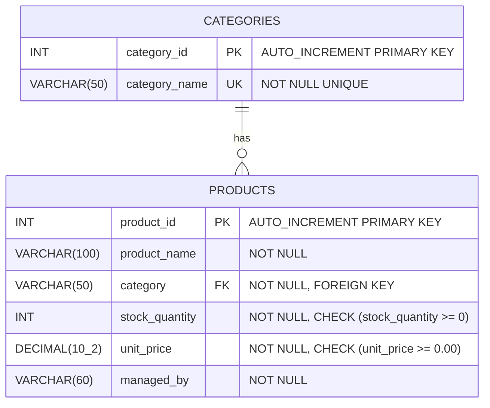
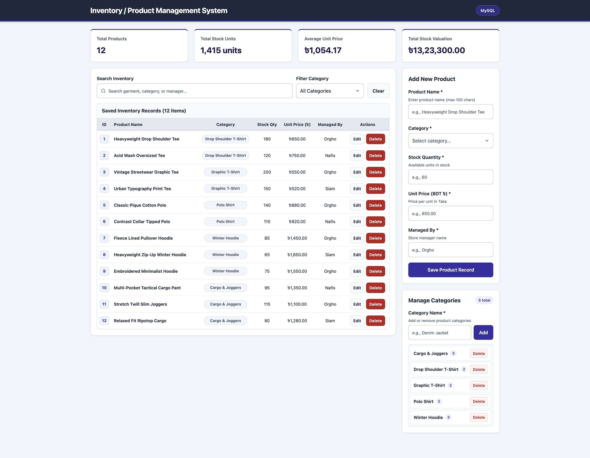
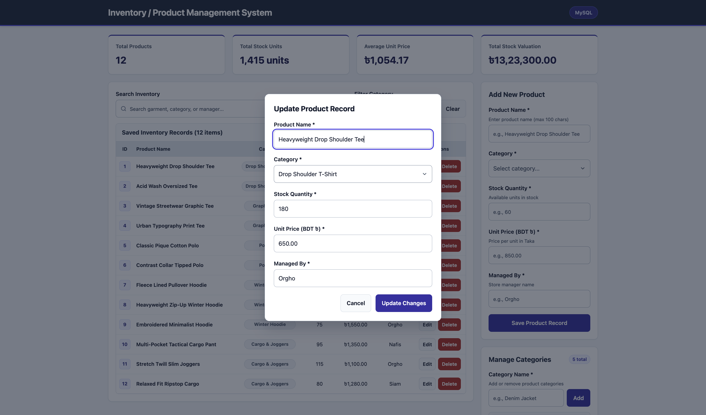

<div align="center">

# FENI UNIVERSITY
### Department of Computer Science and Engineering (CSE)
**Program:** Undergraduate Bachelor of Science (B.Sc. in CSE)

---

### LAB PROJECT REPORT
**Course Title:** Database Management System Lab

<br>

## **Project Title: Inventory / Product Management System**

**GitHub Repository:** https://github.com/Orgho-009/Inventory-Product-Management-System

<br>

---

| **Submitted By** | **Submitted To** |
| :--- | :--- |
| **Name:** Ahmmed Waseg Bin Mizan Orgho | **Name:** Faria Sultana Bintha Rohman |
| **Student ID:** 251031046 | **Designation:** Lab Technical Officer (LTO) |
| **Batch:** CSE 34th Batch | **Department:** B.Sc. in CSE, Feni University |
| **Program:** B.Sc. in CSE | |
| **Department:** Dept. of CSE, Feni University | |

<br>

**Date of Submission:** November 05, 2026

</div>

<div style="page-break-after: always;"></div>

---

## 1. Project Objective

The objective of this project is to develop a single-page web application connected to a relational database to store, retrieve, update, and delete clothing and apparel inventory records. The system demonstrates practical use of SQL commands (`CREATE`, `INSERT`, `SELECT`, `WHERE`, `UPDATE`, `DELETE`) and SQL aggregate functions (`COUNT()`, `SUM()`, `AVG()`) through a clean and responsive user interface.

### Key Features Implemented:
1. **Add Records:** Users can add new garment items and create clothing categories from the web interface.
2. **View Records:** Saved products are displayed in a structured table on the same page with sequential IDs, categories, stock units, prices in Bangladeshi Taka (`৳`), and manager names.
3. **Search and Filter:** Users can search products by ID, garment name, category, or manager name, and filter items by category using SQL `WHERE` and `LIKE` conditions.
4. **Update Records:** Existing product details can be edited and saved using a modal dialog form.
5. **Delete Records:** Unused categories and product records can be deleted after a confirmation prompt.
6. **Summary Information:** Displays total products (`COUNT`), total stock quantity (`SUM`), average unit price (`AVG`), and total stock valuation (`SUM`) formatted in Bangladeshi Taka (Lakh/Crore grouping).

---

## 2. Tools Used & Project File Structure

### 2.1 Technology Stack

| Component | Technology | Description |
| :--- | :--- | :--- |
| **Frontend** | HTML5, CSS3, JavaScript (`index.html`, `style.css`, `script.js`) | Single-page user interface, forms, data table, search bar, and modal dialogs. |
| **Backend** | Node.js, Express (`server.js`) | REST API server handling HTTP requests and executing SQL queries. |
| **Database Driver** | `mysql2` | Connects Node.js with the MySQL database using parameterized queries. |
| **Database** | MySQL (`inventory_db`) | Relational database storing the `categories` and `products` tables. |

### 2.2 GitHub Repository & Project File Structure

- **GitHub Repository Link:** https://github.com/Orgho-009/Inventory-Product-Management-System
- **Online Lab Report (`LAB_REPORT.md`):** https://github.com/Orgho-009/Inventory-Product-Management-System/blob/main/LAB_REPORT.md

```text
Inventory-Product-Management-System/
├── database.sql
├── server.js
├── package.json
├── LAB_REPORT.md
├── public/
│   ├── index.html
│   ├── style.css
│   └── script.js
└── screenshots/
    ├── dashboard-overview.png
    └── edit-record-modal.png
```

---

## 3. Database Table Design & ER Diagram

### 3.1 Entity-Relationship (ER) Diagram
The database `inventory_db` consists of two related tables: `categories` (parent table) and `products` (child table). Each category can have multiple products (`1:N` relationship), linked by a `FOREIGN KEY` on `products.category` referencing `categories(category_name)`.



### 3.2 Table Structure

| Table | Column Name | Data Type | Constraints | Description |
| :--- | :--- | :--- | :--- | :--- |
| `categories` | `category_id` | `INT` | `PRIMARY KEY`, `AUTO_INCREMENT` | Unique ID for each category |
| `categories` | `category_name` | `VARCHAR(50)` | `NOT NULL`, `UNIQUE` | Category name |
| `products` | `product_id` | `INT` | `PRIMARY KEY`, `AUTO_INCREMENT` | Unique ID for each product |
| `products` | `product_name` | `VARCHAR(100)` | `NOT NULL` | Name of the clothing product |
| `products` | `category` | `VARCHAR(50)` | `NOT NULL`, `FOREIGN KEY` | References `categories(category_name)` |
| `products` | `stock_quantity` | `INT` | `NOT NULL`, `CHECK (>= 0)` | Available quantity in stock |
| `products` | `unit_price` | `DECIMAL(10, 2)` | `NOT NULL`, `CHECK (>= 0.00)` | Unit price in BDT (`৳`) |
| `products` | `managed_by` | `VARCHAR(60)` | `NOT NULL` | Name of the store manager |

---

## 4. Key SQL Queries (`database.sql` & `server.js`)

### 4.1 Database and Table Creation (`CREATE`)
```sql
CREATE DATABASE IF NOT EXISTS inventory_db
    CHARACTER SET utf8mb4
    COLLATE utf8mb4_unicode_ci;

USE inventory_db;

CREATE TABLE IF NOT EXISTS categories (
    category_id INT AUTO_INCREMENT PRIMARY KEY,
    category_name VARCHAR(50) NOT NULL UNIQUE
);

CREATE TABLE IF NOT EXISTS products (
    product_id INT AUTO_INCREMENT PRIMARY KEY,
    product_name VARCHAR(100) NOT NULL,
    category VARCHAR(50) NOT NULL,
    stock_quantity INT NOT NULL CHECK (stock_quantity >= 0),
    unit_price DECIMAL(10, 2) NOT NULL CHECK (unit_price >= 0.00),
    managed_by VARCHAR(60) NOT NULL,
    CONSTRAINT fk_products_category
        FOREIGN KEY (category) REFERENCES categories(category_name)
        ON UPDATE CASCADE
        ON DELETE RESTRICT
);
```

### 4.2 Sample Data Insertion (`INSERT`)
```sql
INSERT INTO categories (category_name) VALUES
('Cargo & Joggers'),
('Drop Shoulder T-Shirt'),
('Graphic T-Shirt'),
('Polo Shirt'),
('Winter Hoodie');

INSERT INTO products (product_name, category, stock_quantity, unit_price, managed_by) VALUES
('Heavyweight Drop Shoulder Tee', 'Drop Shoulder T-Shirt', 180, 650.00, 'Orgho'),
('Acid Wash Oversized Tee', 'Drop Shoulder T-Shirt', 120, 750.00, 'Nafis'),
('Vintage Streetwear Graphic Tee', 'Graphic T-Shirt', 200, 550.00, 'Orgho'),
('Urban Typography Print Tee', 'Graphic T-Shirt', 150, 520.00, 'Siam'),
('Classic Pique Cotton Polo', 'Polo Shirt', 140, 880.00, 'Orgho'),
('Contrast Collar Tipped Polo', 'Polo Shirt', 110, 920.00, 'Nafis'),
('Fleece Lined Pullover Hoodie', 'Winter Hoodie', 85, 1450.00, 'Orgho'),
('Heavyweight Zip-Up Winter Hoodie', 'Winter Hoodie', 65, 1650.00, 'Siam'),
('Embroidered Minimalist Hoodie', 'Winter Hoodie', 75, 1550.00, 'Orgho'),
('Multi-Pocket Tactical Cargo Pant', 'Cargo & Joggers', 95, 1350.00, 'Nafis'),
('Stretch Twill Slim Joggers', 'Cargo & Joggers', 115, 1100.00, 'Orgho'),
('Relaxed Fit Ripstop Cargo', 'Cargo & Joggers', 80, 1280.00, 'Siam');
```

### 4.3 View Records and Categories (`SELECT`)
```sql
SELECT c.category_id, c.category_name, COUNT(p.product_id) AS product_count
FROM categories c
LEFT JOIN products p ON p.category = c.category_name
GROUP BY c.category_id, c.category_name
ORDER BY c.category_name ASC;

SELECT product_id, product_name, category, stock_quantity, unit_price, managed_by
FROM products
ORDER BY product_id ASC;
```

### 4.4 Search and Filter Records (`SELECT` with `WHERE` and `LIKE`)
```sql
SELECT product_id, product_name, category, stock_quantity, unit_price, managed_by
FROM products
WHERE (product_id = 1 OR product_name LIKE '%Hoodie%' OR category LIKE '%Hoodie%' OR managed_by LIKE '%Hoodie%')
  AND category = 'Winter Hoodie'
ORDER BY product_id ASC;
```

### 4.5 Update Record (`UPDATE` with `WHERE`)
```sql
UPDATE products
SET product_name = 'Heavyweight Drop Shoulder Tee',
    category = 'Drop Shoulder T-Shirt',
    stock_quantity = 180,
    unit_price = 650.00,
    managed_by = 'Orgho'
WHERE product_id = 1;
```

### 4.6 Delete Record (`DELETE` with `WHERE`)
```sql
DELETE FROM products
WHERE product_id = 12;

DELETE FROM categories
WHERE category_id = 5;
```

### 4.7 Summary Queries Using Aggregate Functions (`COUNT`, `SUM`, `AVG`)
```sql
SELECT
    COUNT(*) AS total_products,
    COALESCE(SUM(stock_quantity), 0) AS total_stock,
    COALESCE(ROUND(AVG(unit_price), 2), 0) AS average_price,
    COALESCE(ROUND(SUM(stock_quantity * unit_price), 2), 0) AS total_inventory_value
FROM products;
```

| Total Products (`COUNT(*)`) | Total Stock Units (`SUM(stock_quantity)`) | Average Unit Price (`AVG(unit_price)`) | Total Stock Valuation (`SUM(qty * price)`) |
| :---: | :---: | :---: | :---: |
| **12** | **1,415 units** | **৳1,054.17** | **৳13,23,300.00** |

---

## 5. Screenshots of the Working Application

### Figure 1: Main Single-Page Inventory Interface


### Figure 2: Update Product Record Modal


---

## 6. How to Run the Project

1. **GitHub Repository:** https://github.com/Orgho-009/Inventory-Product-Management-System
2. **Database Setup:** Start the local MySQL server (e.g., via XAMPP or MySQL Server on `localhost:3306` with user `root`). Import `database.sql` in phpMyAdmin or MySQL CLI (`mysql -u root < database.sql`), or simply start the server and it will run `database.sql` automatically on first launch.
3. **Install Packages and Start Server:** Open a terminal in the project folder and run:
   ```bash
   npm install
   npm start
   ```
4. **Open in Browser:** Go to `http://localhost:3000` in any web browser.

---

## 7. Conclusion

This project successfully implements a single-page Inventory / Product Management System using HTML, CSS, JavaScript, Node.js, and MySQL. It fulfills all course requirements by demonstrating relational table design with primary and foreign keys, complete CRUD operations, search and category filtering with `WHERE` clauses, and live summary calculations using SQL aggregate functions.
